

  

  <b>A free project manager that keeps your work on your own computer.</b> 
  Pages, boards, tables, timelines and charts — with Scope AI that plans a whole project from one sentence.

  <a href="https://github.com/SamayW/scope-releases/releases/latest/download/Scope-mac-arm64.dmg"><b>⬇ Download Scope for Mac</b></a> (Apple Silicon · always the newest version)

---

## Download

| Your computer | File |
|---|---|
| Mac with Apple Silicon (M1, M2, M3, M4…) | **[Download Scope.dmg](https://github.com/SamayW/scope-releases/releases/latest/download/Scope-mac-arm64.dmg)** — one click, always the latest |
| Intel Mac · Windows | Not yet — coming soon |

### Install
1. Open the `.dmg` and drag **Scope** into **Applications**.
2. The first time, macOS says Scope “can't be verified” (it isn't notarised by Apple yet).
   Open **System Settings → Privacy & Security**, scroll down and click **Open Anyway**, then open Scope again.
3. Sign in with a passkey (Touch ID) and pick how you'll use Scope. That's it.

When a new version is out, Scope shows “Version X is available” — one click on **Download** gets the new installer.

## What's inside

<table>
  <tr>
    <td width="50%" valign="top">
      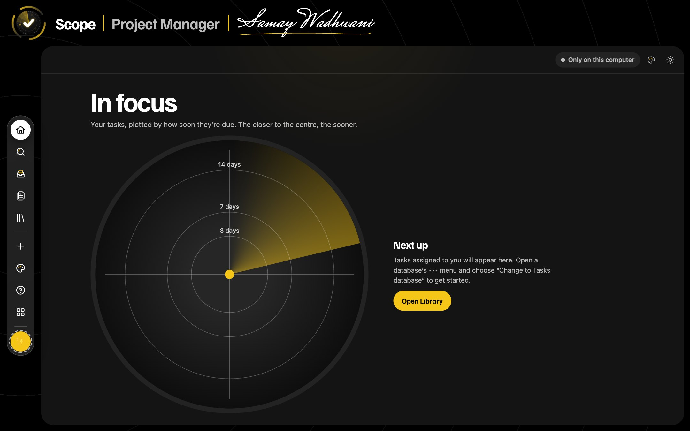
      
<b>In focus.</b> Home is a radar: your tasks plotted by due date — the closer to the centre, the sooner.

    </td>
    <td width="50%" valign="top">
      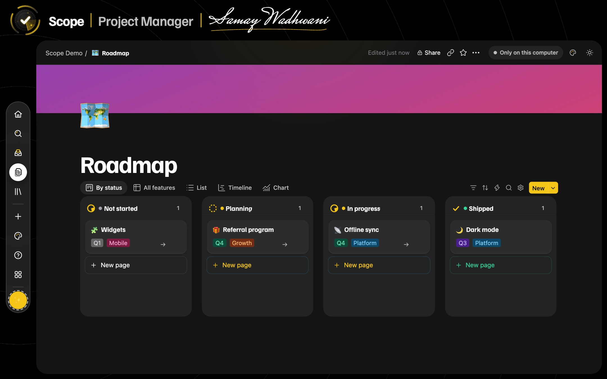
      
<b>Boards.</b> Drag work across stages; cards show owners, dates and progress.

    </td>
  </tr>
  <tr>
    <td width="50%" valign="top">
      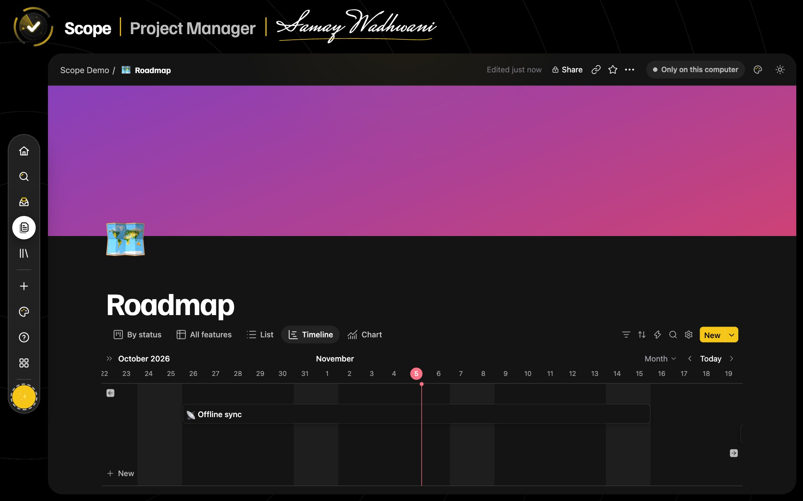
      
<b>One database, many views.</b> Board, table, list, timeline, calendar, gallery, mind map and workflow.

    </td>
    <td width="50%" valign="top">
      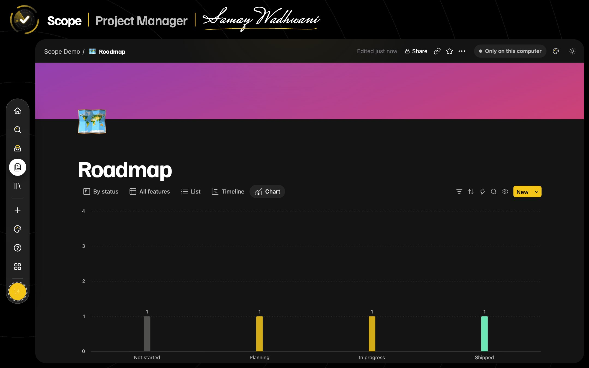
      
<b>Charts and dashboards</b> straight from your data, with formulas, relations and automations.

    </td>
  </tr>
  <tr>
    <td width="50%" valign="top">
      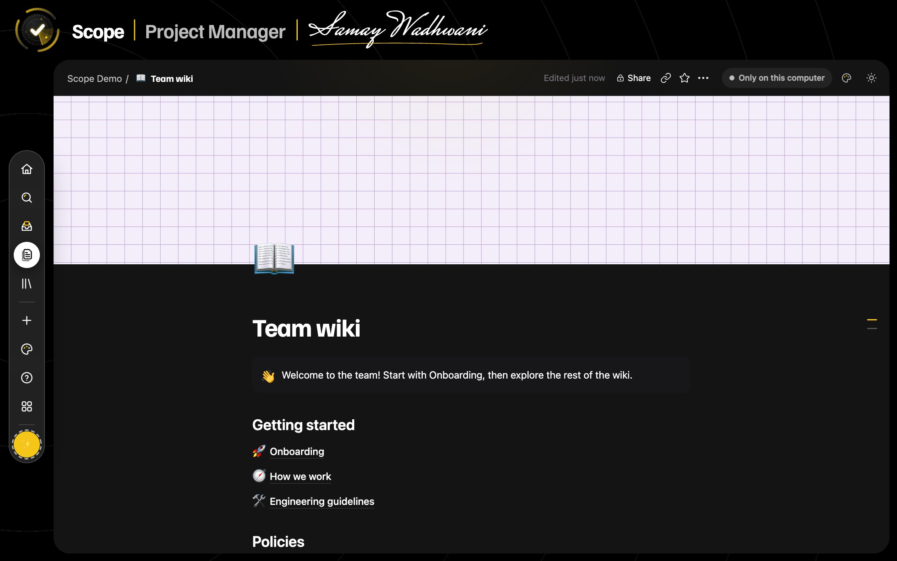
      
<b>Block editor.</b> Slash menu, markdown shortcuts, mentions, comments, suggested edits and version history.

    </td>
    <td width="50%" valign="top">
      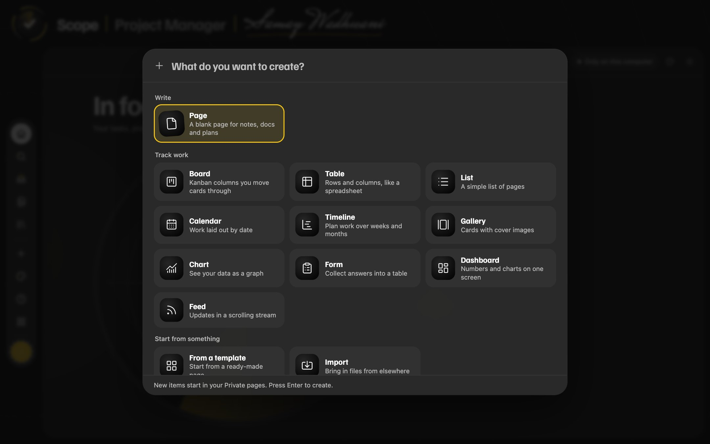
      
<b>One + for everything:</b> page, board, table, list, calendar, timeline, gallery, chart, form, dashboard, feed.

    </td>
  </tr>
</table>

## Scope AI

Ask *“Plan a product launch in 6 weeks”* and Scope AI builds the project — tasks, owners, dates, milestones and views — from one of 56 project templates, asking only what it can't work out from your workspace. Decisions and deadlines from your chats are saved to each project's knowledge.

<table>
  <tr>
    <td width="50%" valign="top">
      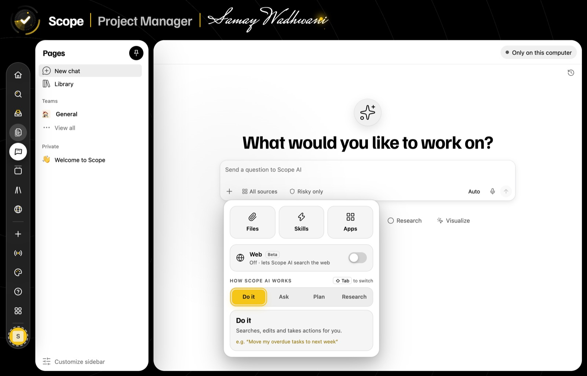
      
<b>Modes.</b> Do it, Ask, Plan or Research — plus files, skills, connected apps and web search.

    </td>
    <td width="50%" valign="top">
      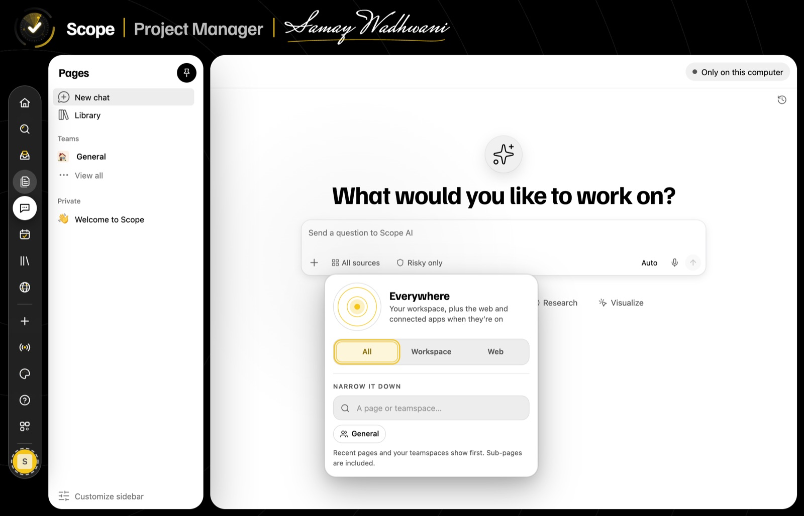
      
<b>Where to look.</b> Everywhere, just your workspace, the web, or one page or teamspace.

    </td>
  </tr>
  <tr>
    <td width="50%" valign="top">
      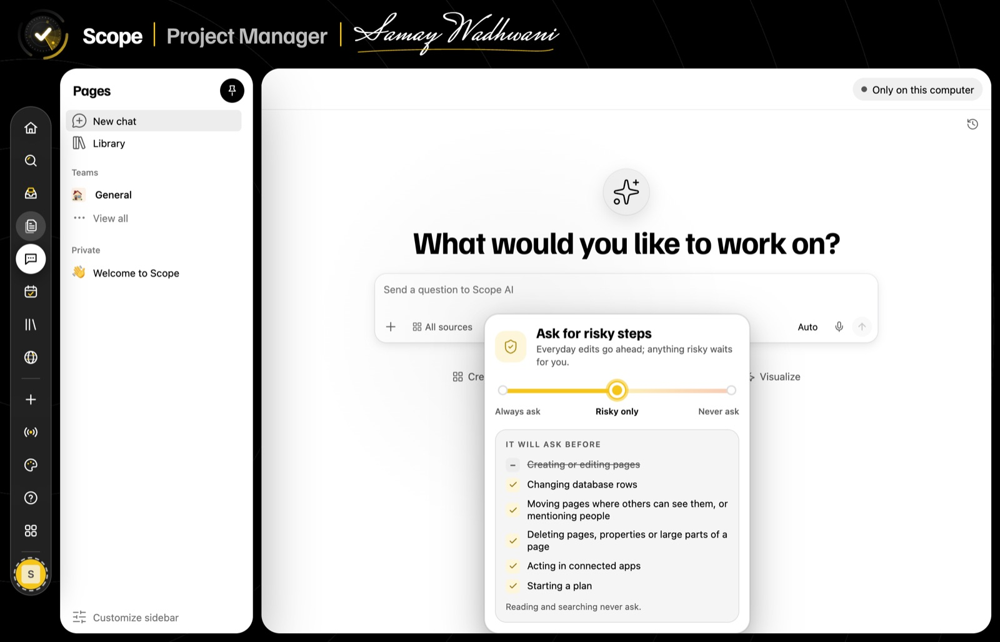
      
<b>You stay in charge.</b> Choose when Scope AI stops to ask before it changes anything.

    </td>
    <td width="50%" valign="top">
      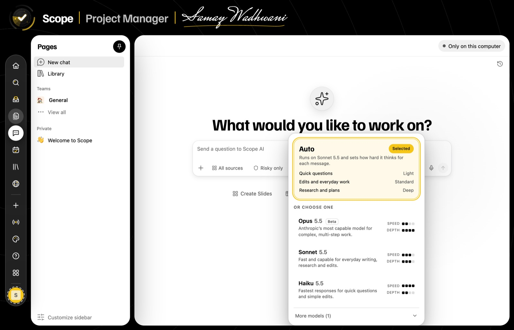
      
<b>Pick a model</b> or let Auto decide how hard to think for each message.

    </td>
  </tr>
</table>

**Plans:** the app is free. Scope AI includes a free allowance (30 actions a day, 3 project kickoffs a month); **AI Plus** is AED 29 a month or AED 290 a year. Or use your own Anthropic/OpenAI key, or a free local model.

## Themes

  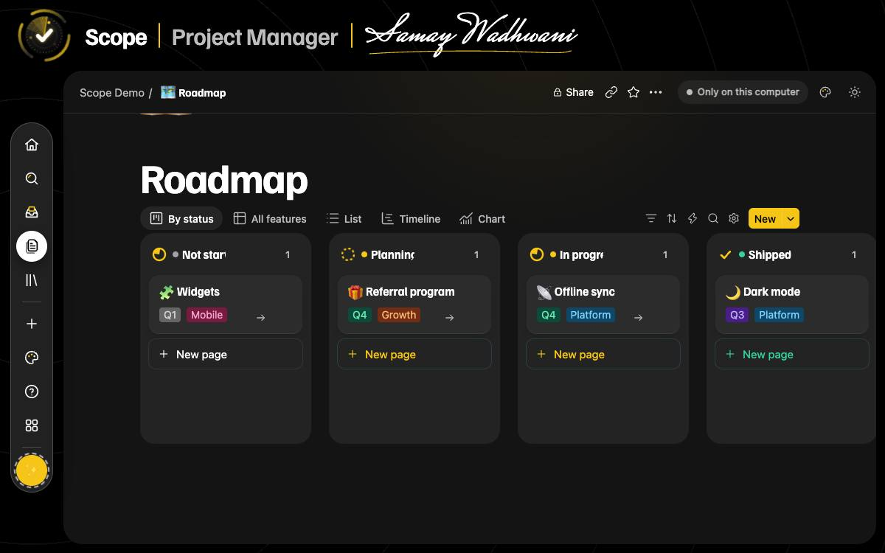
  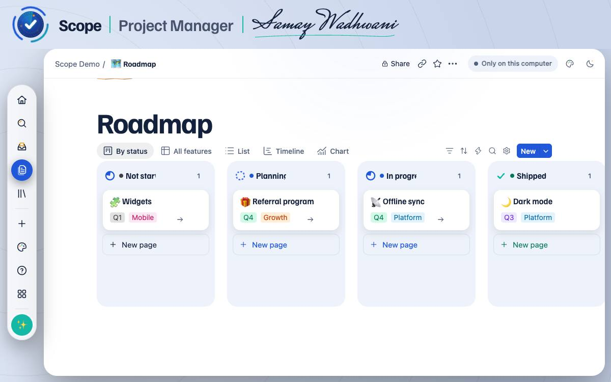
  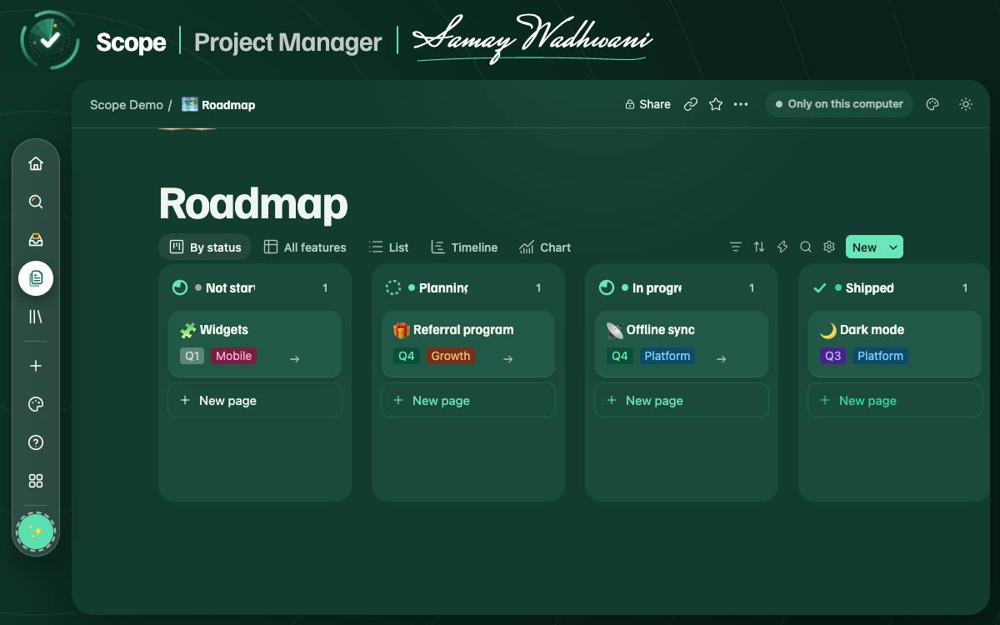
  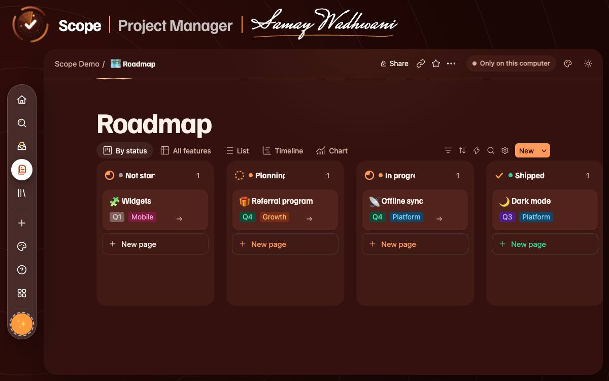

## Your data
Everything lives in one file on your own Mac. Nothing is sent anywhere unless you use Scope AI or share a page. Turn on encryption in Settings to seal your data with a key only your computer holds.

---

Made by <b>Samay Wadhwani</b> · <a href="https://github.com/SamayW/scope-releases/releases">All releases</a>

