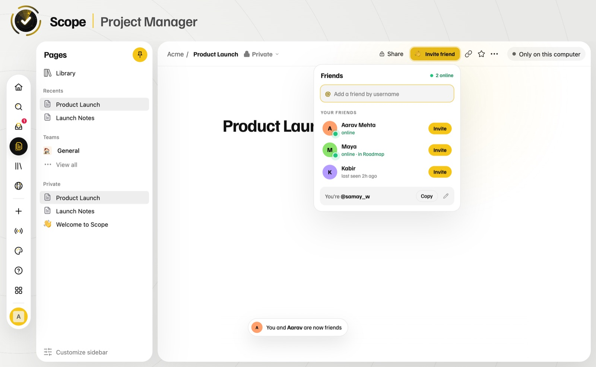
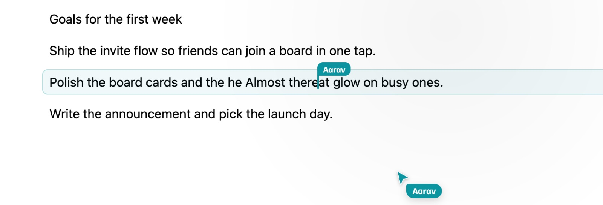
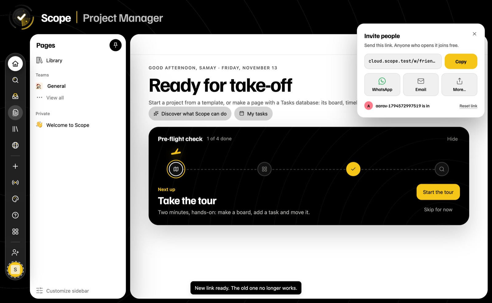
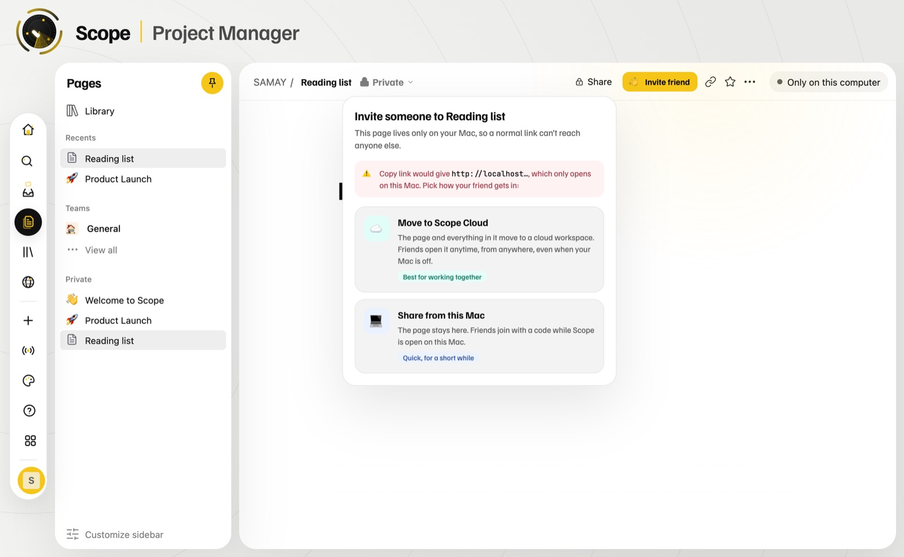

  

<h3 align="center">Plan it. Build it. Do it together.</h3>

  Pages, boards, tables, timelines and charts in one Mac app, 
  with Scope AI that plans a whole project from one sentence, and friends you can bring in from anywhere.

  

  
  &nbsp;Always the newest version

  

## Download

| Your computer | |
|---|---|
| Mac with Apple Silicon (M1, M2, M3, M4…) | **[Download Scope](https://github.com/SamayW/scope-releases/releases/latest/download/Scope-mac-arm64.dmg)**, always the latest |
| Intel Mac, Windows | Coming soon |

### Install

1. Open the file and drag **Scope** into **Applications**. Or just open Scope: it offers to move itself there and tidies up the installer.
2. The first time, macOS says Scope "can't be verified" because it isn't notarised by Apple yet. Open **System Settings › Privacy & Security**, scroll down, click **Open Anyway**, then open Scope again.
3. Sign in once with your email. There's no password: you get a 6-digit code.

From version 1.1 on, Scope updates itself. When a new version is ready you'll see **Restart to update**, and your work is never touched.

## What's inside

<table>
  <tr>
    <td width="50%" valign="top">
      
      
<b>In focus.</b> Home is a radar: your tasks plotted by due date. The closer to the centre, the sooner.

    </td>
    <td width="50%" valign="top">
      
      
<b>Boards.</b> Drag work across stages. Cards show owners, dates and progress.

    </td>
  </tr>
  <tr>
    <td width="50%" valign="top">
      
      
<b>One database, many views.</b> Board, table, list, timeline, calendar, gallery, mind map and workflow.

    </td>
    <td width="50%" valign="top">
      
      
<b>Charts and dashboards</b> straight from your data, with formulas, relations and automations.

    </td>
  </tr>
  <tr>
    <td width="50%" valign="top">
      
      
<b>Block editor.</b> Type <b>/</b> for a grid of every block, plus markdown shortcuts, mentions, comments and version history.

    </td>
    <td width="50%" valign="top">
      
      
<b>One + for everything:</b> page, board, table, list, calendar, timeline, gallery, chart, form, dashboard and feed.

    </td>
  </tr>
</table>

## Work together

<table>
  <tr>
    <td width="50%" valign="top">
      
      
<b>Friends.</b> Everyone has an @username. Add a friend, then invite them to any board or page. They tap <b>Join</b> in their Inbox.

    </td>
    <td width="50%" valign="top">
      
      
<b>See each other live.</b> Cursors with names, where someone is typing, and who's on the page.

    </td>
  </tr>
  <tr>
    <td width="50%" valign="top">
      
      
<b>Cloud workspaces.</b> One link to send. Anyone who opens it joins free, from a Mac or any browser.

    </td>
    <td width="50%" valign="top">
      
      
<b>Share a page from your Mac.</b> Move it to Scope Cloud with all its data, or share it from your Mac for a while.

    </td>
  </tr>
</table>

## Scope AI

Ask *"Plan a product launch in 6 weeks"*. Scope AI first asks what you're launching, who's on it and when it's due, then builds the project: tasks, owners, dates, milestones, views, and a cover image. Decisions and deadlines from your chats are saved to each project's knowledge.

<table>
  <tr>
    <td width="50%" valign="top">
      
      
<b>Modes.</b> Do it, Ask, Plan or Research, plus files, skills, connected apps and web search.

    </td>
    <td width="50%" valign="top">
      
      
<b>Where to look.</b> Everywhere, just your workspace, the web, or one page or teamspace.

    </td>
  </tr>
  <tr>
    <td width="50%" valign="top">
      
      
<b>You stay in charge.</b> Choose when Scope AI stops to ask before it changes anything.

    </td>
    <td width="50%" valign="top">
      
      
<b>Pick a model</b> or let Auto decide. Images are real pictures: "/image", page covers and Edit with AI.

    </td>
  </tr>
</table>

## Plans

| | Free | AI Plus | Team |
|---|---|---|---|
| Pages, databases, every view, themes | ✓ | ✓ | ✓ |
| Friends, invites, live presence | ✓ | ✓ | ✓ |
| Join other people's cloud workspaces | ✓ | ✓ | ✓ |
| Your own cloud workspaces | – | 3, up to 10 people each | 10, up to 50 people each |
| Scope AI | 30 actions a day | 300 actions a day | 300 actions a day |
| AI images | 5 a month | 100 a month | 100 a month per seat |

**AI Plus** is AED 29 a month or AED 290 a year. You can also use your own Anthropic or OpenAI key, or a free local model.

## Themes

  
  
  
  

## Your data

- **Your pages live on your Mac.** Signing in doesn't upload them. Updates never touch them.
- **Scope Cloud** holds your account, your plan and your friends list, plus any cloud workspace you create. Cloud workspaces are encrypted.
- **Scope AI** sees your content only when you use it, and reads your workspace only if you allow it in Settings.
- **Encryption on your Mac:** turn it on in Settings to seal your data with a key only your computer holds.

---

Made by <b>Samay Wadhwani</b> · <a href="https://github.com/SamayW/scope-releases/releases">All releases</a>

